<h1 align="center">Felipe Reducino</h1>

  Principal Front-End Engineer · I build the platforms other front-ends stand on.

  <picture>
    <source media="(prefers-color-scheme: dark)" srcset="./assets/hero-dark.svg">
    <source media="(prefers-color-scheme: light)" srcset="./assets/hero-light.svg">
    
  </picture>

  
  

